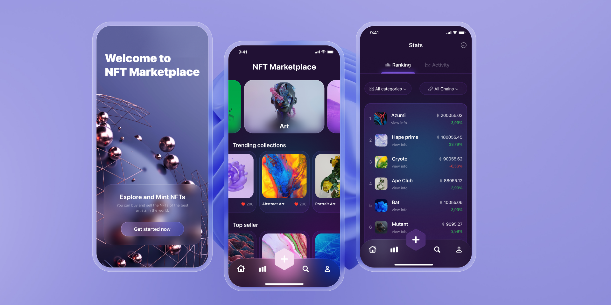

# NFT Marketplace Mobile App

A sleek, modern **NFT Marketplace** mobile application built with **Flutter** and **Dart**, crafted with a **Glassmorphism** aesthetic, smooth scrolling performance, and scalable **Feature-First Architecture**.

---

## Features

- Onboarding: Welcome screen with navigation to the main app shell.
- Home: Horizontal feeds for categories, trending collections, top sellers, and hot new items with ETH prices and likes.
- Stats: Leaderboard rankings with 24h percentage changes, floor prices, and category/chain filter toggles.
- Navigation: Custom frosted-glass bottom bar with a central mint button and tab persistence via `IndexedStack`.

## Status

Work in progress. Core UI screens and navigation are completed. Currently working on:
- Search and Profile screens
- Minting flow

## Getting Started

1. Clone the repository:
   `git clone https://github.com/mosalam05/nft-marketplace-app.git
   cd nft_marketplace`

2. Install dependencies:
   `flutter pub get`

3. Run the app:
   `flutter run`